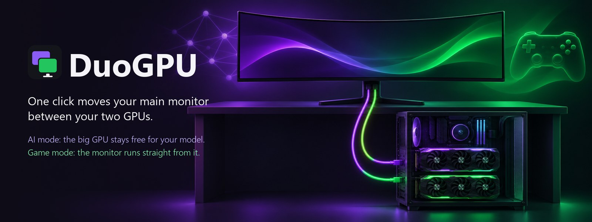
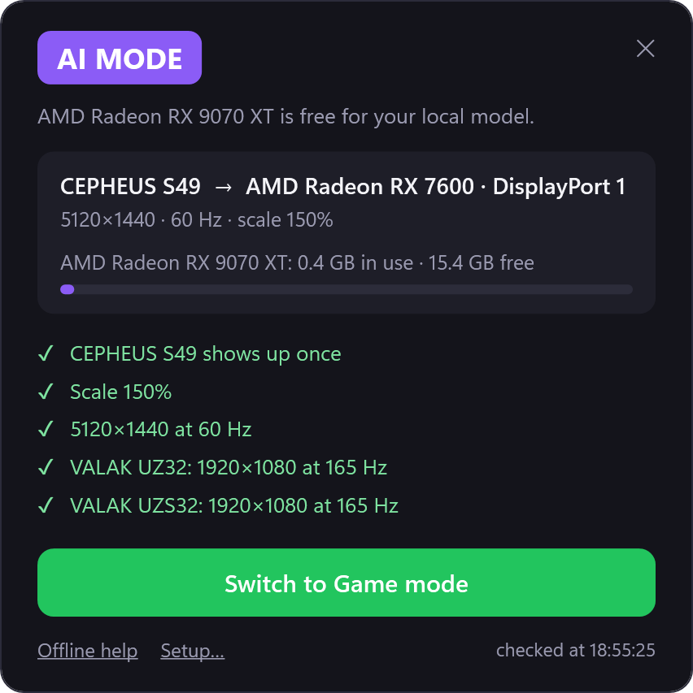
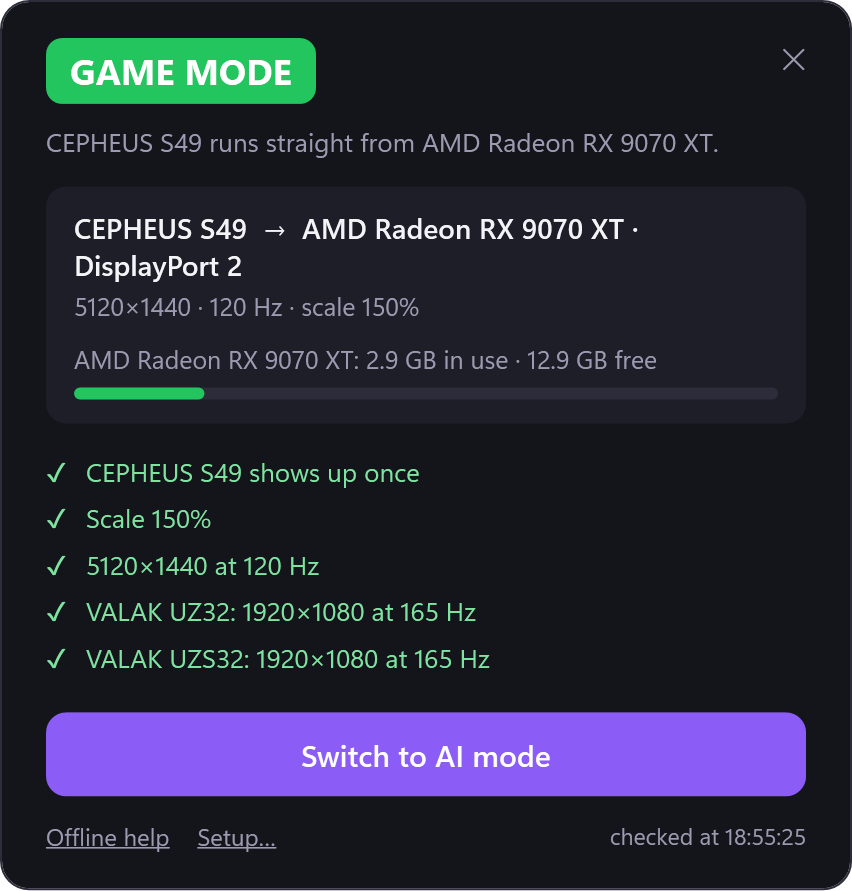
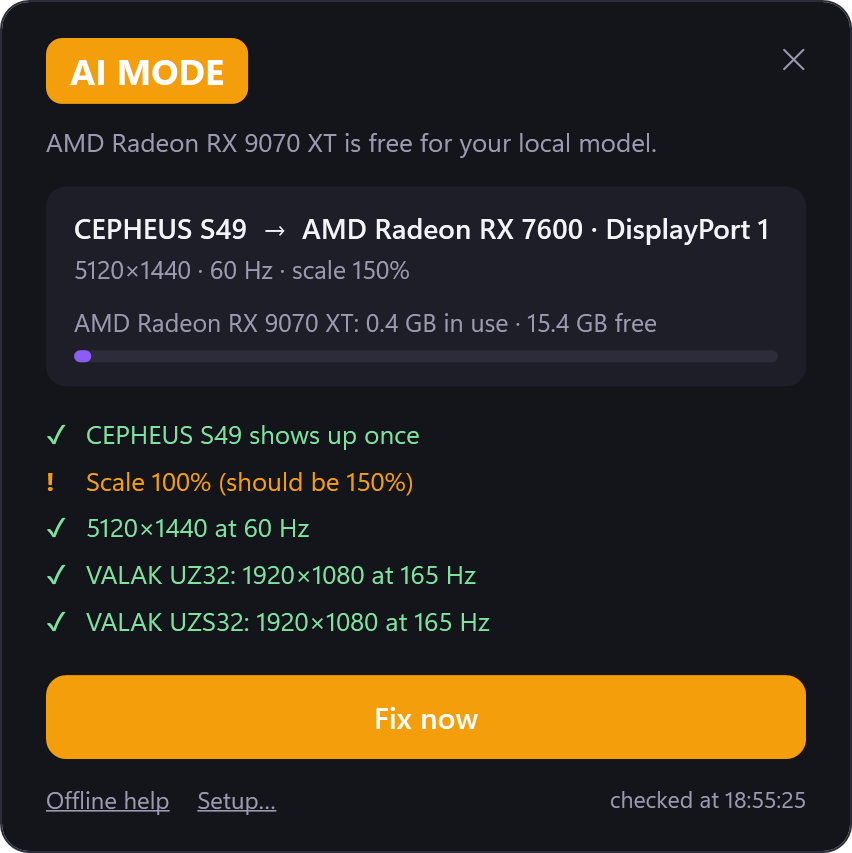
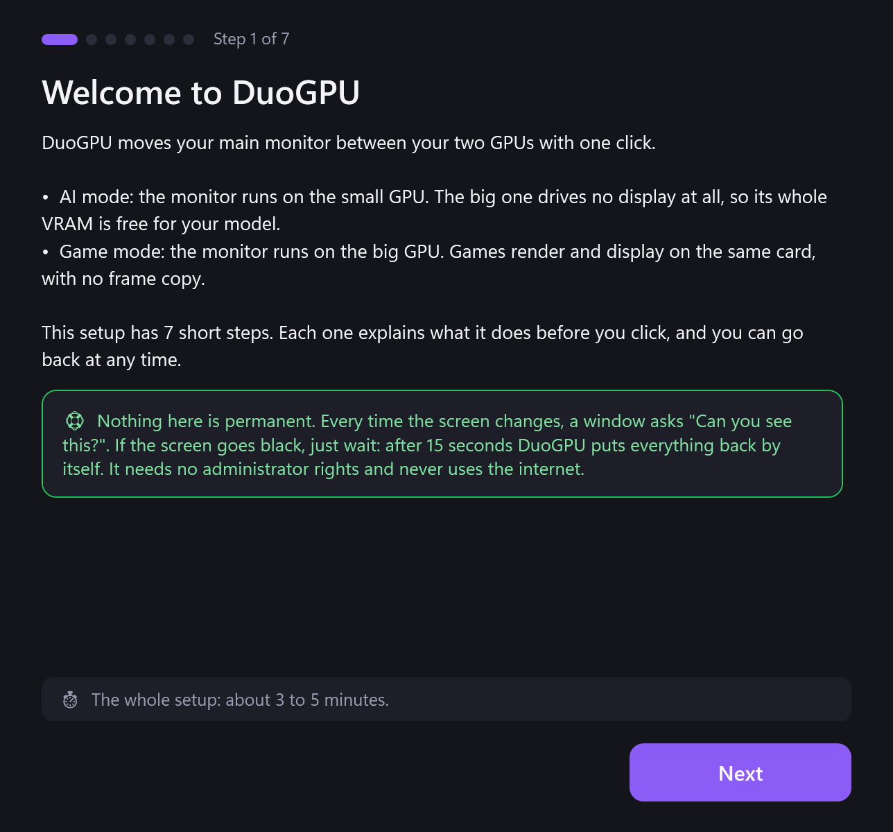
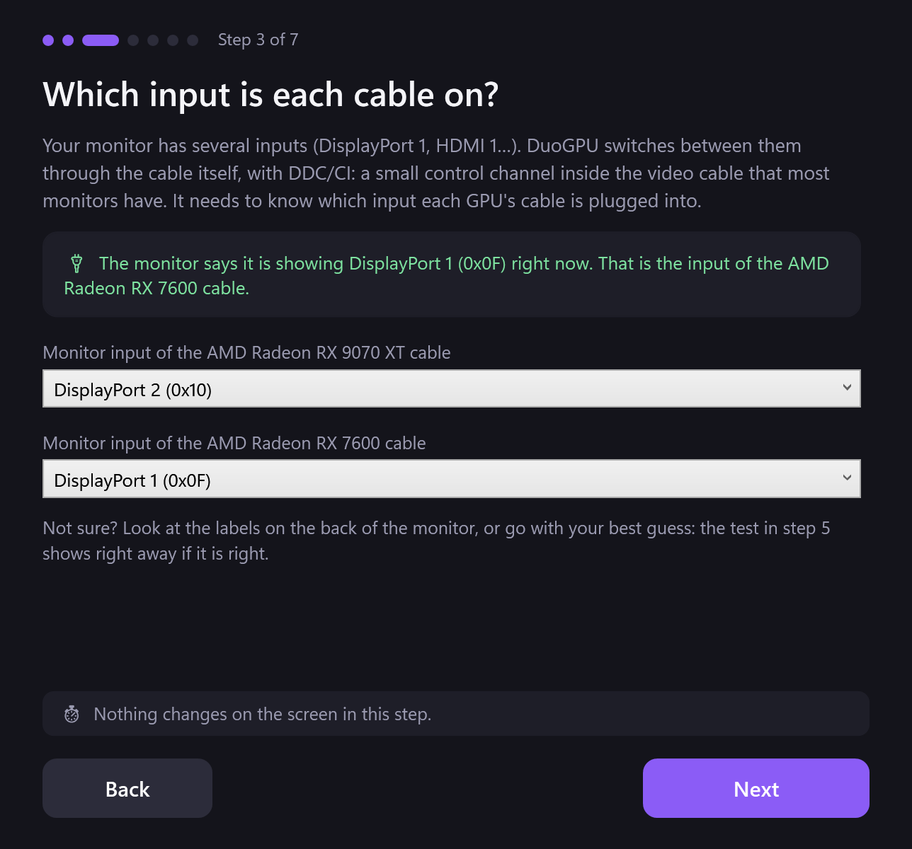
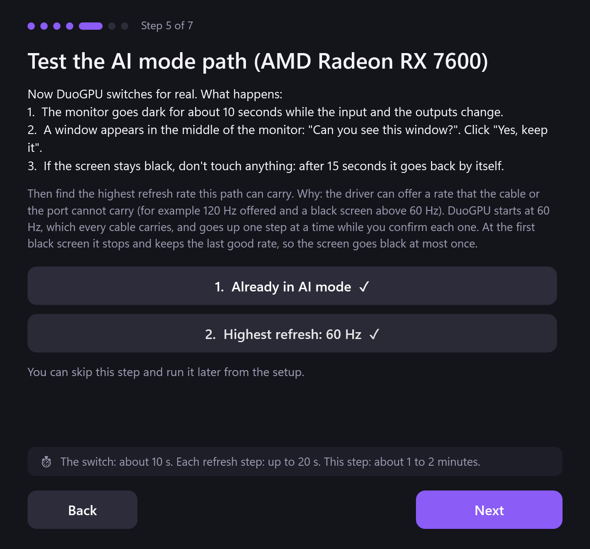
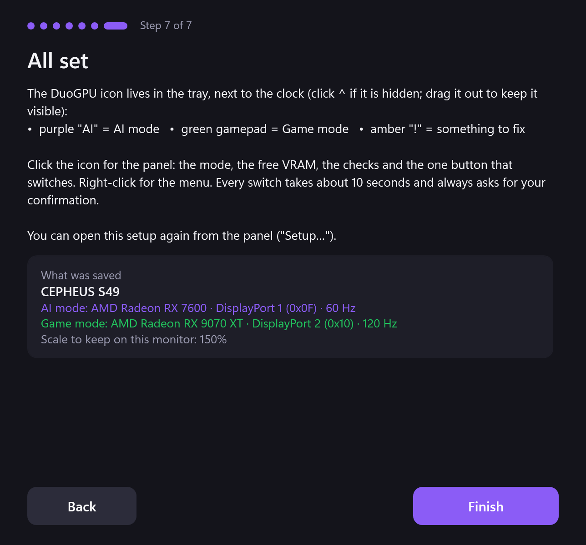
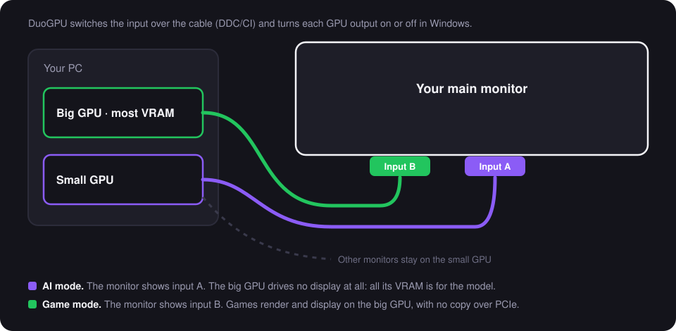

<p align="center">
  
</p>

# DuoGPU: one click moves your main monitor between your two GPUs

[](https://github.com/ThalzeronLabs/duogpu/actions/workflows/ci.yml)
[](https://github.com/ThalzeronLabs/duogpu/releases/latest)
[](#requirements)
[](src/DuoGPU)
[](LICENSE)

**English** · [Português (Brasil)](README.pt-BR.md)

You run AI models locally on a PC with **two GPUs**: a big one with lots of VRAM and a smaller one. You want the big
GPU completely free for the model, but your main monitor is plugged into it, and Windows' compositor and your
browser quietly keep gigabytes of VRAM and part of the GPU busy. Plug the monitor into the small GPU and the problem
goes away... until you want to play, when the monitor has to go back to the big one.

**DuoGPU fixes that with a second cable instead of a cable swap.** Plug your main monitor into *both* GPUs, one cable
each, into two different inputs of the monitor. Then one click:

- **AI mode:** the monitor shows the small GPU's input. The big GPU drives no display at all: its whole VRAM is for
  your model.
- **Game mode:** the monitor shows the big GPU's input. Games render and display on the same card, with no frame
  copy over PCIe.

DuoGPU switches the monitor's input through the cable itself (DDC/CI), turns each GPU's output on or off in Windows,
keeps your layout, scale and refresh rate, and asks *"Can you see this?"* after every switch, going back by itself if
nobody answers. A tray icon always shows the mode you are in.

## What changes

Measured on my PC (Radeon RX 9070 XT 16 GB + Radeon RX 7600 8 GB, a 5120×1440 monitor and two 1920×1080 ones),
12 November 2026, idle desktop:

| | Monitor on the big GPU | **AI mode** (monitor on the small GPU) |
|---|---|---|
| VRAM in use on the big GPU | 2.93 GB | **0.42–0.50 GB** |
| 3D load on the big GPU from other programs | up to 45% (the Windows compositor, `dwm.exe`) | **0%** |
| A 27B model (Q4_K_M, K/V cache q8), generation | 53.3 tokens/s | 53.0 tokens/s (52.9 · 53.0 · 53.3) |
| The same model, prompt processing | 7.6 s | 7.4 s |

That is about **2.5 GB more VRAM** for the model with nothing else changed, enough for a bigger quantization or a
longer context. **It is not a speed boost:** with this 27B model, generation stayed the same (within the noise) and
the prompt was about 3% faster. That model (about 16.5 GB with its cache) does not fit in the big GPU alone, and the
part that spills to the small one now shares it with the monitors, so a model that fits entirely on the big GPU may
behave differently. What DuoGPU gives you for sure is the memory and a big GPU no other program touches.

## Screenshots

| AI mode | Game mode | Something is off | After a switch |
|---|---|---|---|
|  |  |  |  |

The tray icon:  AI mode, Game mode, needs attention.

These images are rendered by the app's own panel code (`DuoGPU.exe render docs/images`). AI mode uses the live
values from my PC; Game mode and the warning use values measured on the same PC.

## The guided setup

The first time you open DuoGPU, a seven-step setup walks you through everything. Each step says what it is going to
do, why, and how long it takes, before you click anything.

| 1. Welcome | 3. The inputs | 5. Test a path | 7. All set |
|---|---|---|---|
|  |  |  |  |

The other steps show what DuoGPU found (your GPUs, the monitor with two cables), your preferences (scale, start with
Windows, language) and the test of the Game mode path.

## How long things take

| Step | Time |
|---|---|
| One switch | about 10 s (measured: 9.8 s and 9.9 s) |
| If nobody confirms (black screen) | 15 s, then it goes back by itself |
| The refresh test of one path | about 1 to 2 min (each step up to 20 s) |
| The whole first setup | about 3 to 5 min |
| One guard check | a few milliseconds, every 5 s |

**Everything in detail** (what happens in each mode, each step of a switch, every check and why, where files live):
[docs/how-it-works.md](docs/how-it-works.md).

## How it works

<p align="center">
  
</p>

A switch follows an order that was tested on real hardware:

1. **The monitor input first, through the cable it is showing now.** Many monitors answer DDC/CI only on the active
   input, so DuoGPU sends VCP code `0x60` (input source) before touching anything else.
2. **The other GPU's output turns on** at the same position, size and primary flag, at the highest refresh rate that
   path is known to carry.
3. **The old output turns off**, so Windows does not see the monitor twice.
4. **The scale goes back** to yours: Windows keeps one scale per cable and resets it on every switch.
5. **"Can you see this window?"** If nobody clicks *Keep* within 15 seconds (because the screen is black), DuoGPU
   undoes the switch, just like Windows does after a resolution change.

A **guard** checks the displays every 5 seconds. It quietly puts back what can never black out the screen (the scale,
the tested refresh rate, and the size, refresh rate and place of your *other* monitors as you saved them) and turns the icon amber, with a *Fix now* button, for anything else, such as the monitor
showing up twice.

> **Why a tested refresh limit?** The driver can offer a refresh rate that the cable or port cannot carry. On my PC,
> Windows offered 120 Hz on the small GPU's DisplayPort path and the screen went black at 75, 100 and 120 Hz; 60 Hz
> worked. The setup finds that limit with you watching, one step at a time, and DuoGPU never goes above it.

Everything uses public Windows APIs: DXGI for the GPUs, the display configuration API for the paths and the scale,
the classic display settings API for the outputs, `dxva2` for DDC/CI and the performance counters for VRAM. So it
works the same way with AMD, NVIDIA and Intel cards. It needs no administrator rights and sends nothing over the
network.

## Requirements

- Windows 10 or Windows 11, x64.
- Two GPUs, each with its own display outputs.
- A main monitor with two free inputs, and one cable from each GPU to it.
- **DDC/CI turned on** in the monitor's menu (most monitors ship with it on). Without it DuoGPU still works: it asks
  you to press the monitor's input button.

**Tested on:** Radeon RX 9070 XT + Radeon RX 7600 with a 5120×1440 DisplayPort monitor: a switch in each direction, confirmed on screen, about 10 s each (12 Nov 2026). If it works (or not) on
your hardware, please [open an issue](https://github.com/ThalzeronLabs/duogpu/issues) with the output of
`DuoGPU.exe detect`: it is the fastest way to grow the list.

## Install

1. Download `DuoGPU-vX.Y.Z-win-x64.zip` from the [latest release](https://github.com/ThalzeronLabs/duogpu/releases/latest)
   and unzip it anywhere (for example `%LOCALAPPDATA%\Programs\DuoGPU`). It is a single `.exe` with .NET included.
   A smaller `-framework` build is there too, if you already have the .NET 10 Desktop Runtime.
2. Run `DuoGPU.exe`. The exe is not code-signed yet, so Windows SmartScreen may ask *"Run anyway?"* the first time.
   Each release lists the SHA-256 of its files.
3. The setup opens by itself:
   - it shows the monitor it found on both GPUs and picks the GPU with the most VRAM for AI;
   - it reads the input on screen now over DDC/CI; you pick the input where the other GPU's cable is;
   - steps 5 and 6 switch for real to each mode and find the highest refresh rate of each path, with you confirming.
4. The icon lives in the tray (the `^` next to the clock). Drag it out to keep it always visible.

## Command line

```text
DuoGPU.exe              the tray app (the setup opens the first time)
DuoGPU.exe detect       what DuoGPU sees: GPUs, outputs, the dual-cabled monitor (changes nothing)
DuoGPU.exe status       the current mode and the guard's checks
DuoGPU.exe ai           AI mode
DuoGPU.exe game         Game mode
DuoGPU.exe toggle       the other mode
DuoGPU.exe fix          the guard's safe repairs, once
DuoGPU.exe remember     save the other monitors as they are now
  --no-confirm          skip "Can you see this?" (for scripts, only after a tested switch)
```

So a script that starts your model server can call `DuoGPU.exe ai` first, and a game launcher can call
`DuoGPU.exe game`. Exit code 0 means success.

## No second cable?

You can leave the monitor on the small GPU and still play on the big one: Windows can render a game on one GPU and
show it on another (*Settings → System → Display → Graphics*). Each frame is then copied over PCIe, which costs some
FPS and adds latency, more so when the small GPU sits in a chipset slot. DuoGPU's two-cable setup avoids that copy.

## Build it yourself

```bash
dotnet test tests/DuoGPU.Tests
dotnet publish src/DuoGPU -c Release -r win-x64 --self-contained -p:PublishSingleFile=true
```

The tests cover the parts that do not need hardware: the EDID monitor ids, the DDC/CI capabilities parser, the
refresh choice under a tested limit and the configuration file. The display code is exercised on real hardware
before each release.

## Roadmap

- In AI mode, move the browser and chat apps to the small GPU too (Windows' per-app GPU preference) and show which
  programs still use the big one.
- A `winget` package.
- More than one monitor with two cables.

## How I build this

I use AI assistance (Claude) while I build this project: for drafting, exploring options and writing tests. The banner
illustration was made with an image model. I review every change myself, test each release on my own two-GPU PC, and
I'm responsible for every line.

## About

DuoGPU started as a small script for my own desk, where I run local language models next to a gaming setup, and
became a tool once it worked well enough to share. I'm Esdras Souza, an Android and AI developer, and I publish my open
projects under [Thalzeron Labs](https://thalzeronlabs.github.io/Site-Oficial/). Other repositories:
[llama-kotlin](https://github.com/ThalzeronLabs/llama-kotlin) (LLMs on Android) and
[android-on-device-llm](https://github.com/ThalzeronLabs/android-on-device-llm) (a private AI chat that runs on the phone).

## License

Apache-2.0 © Esdras Souza (Thalzeron Labs). See [LICENSE](LICENSE).
