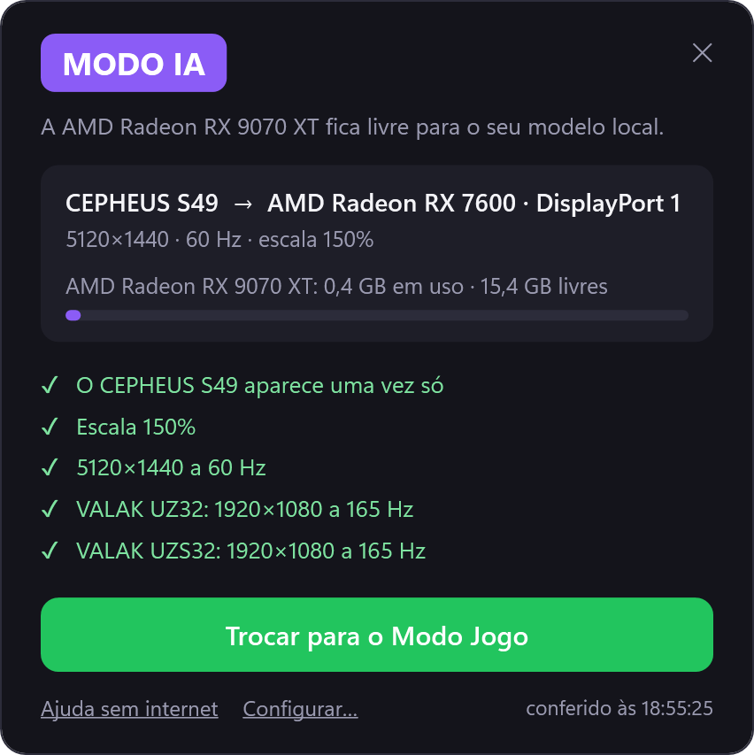
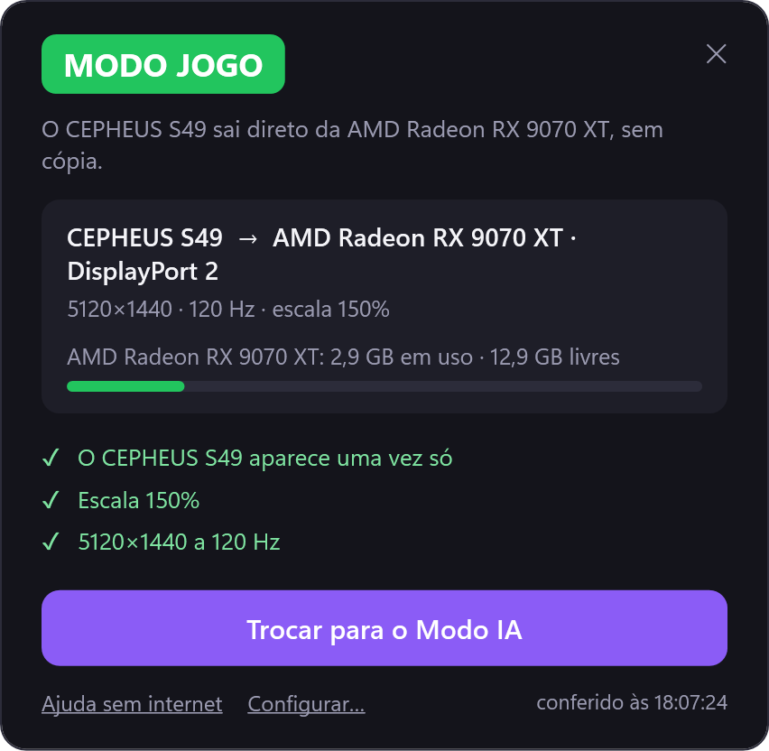
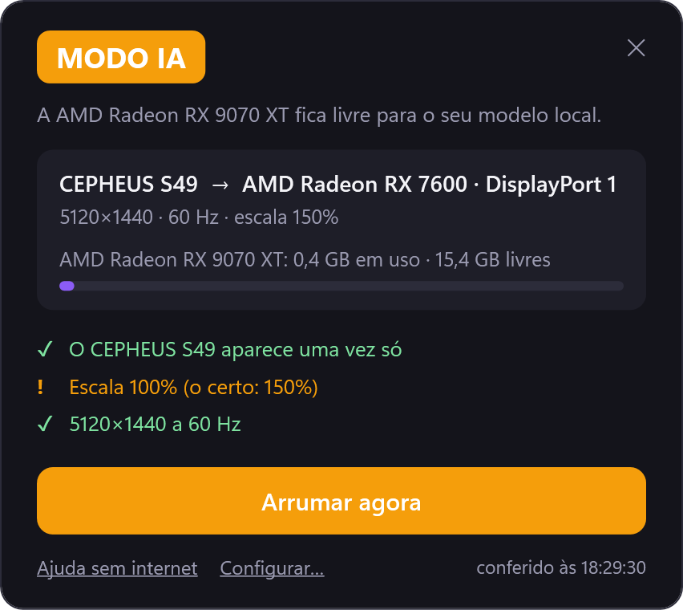
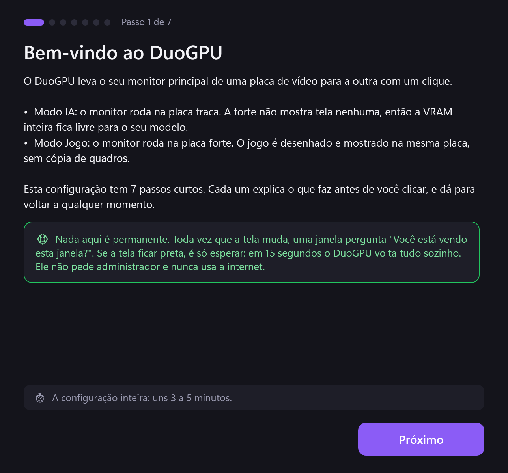
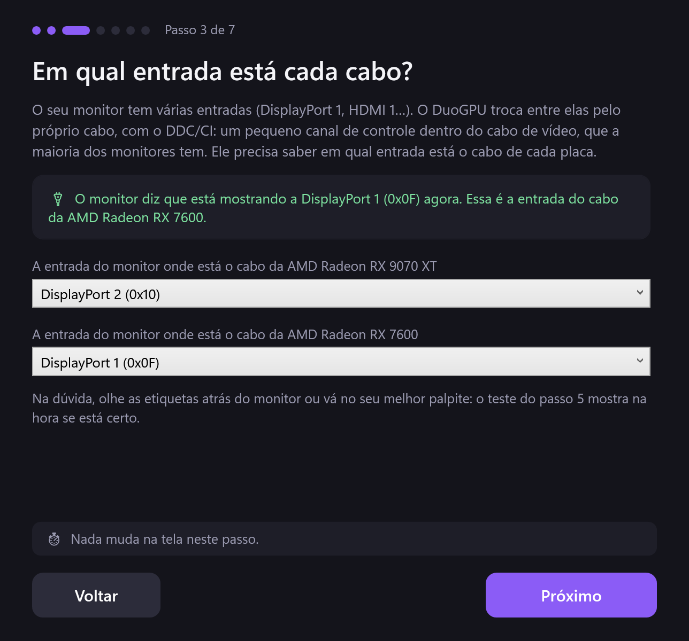
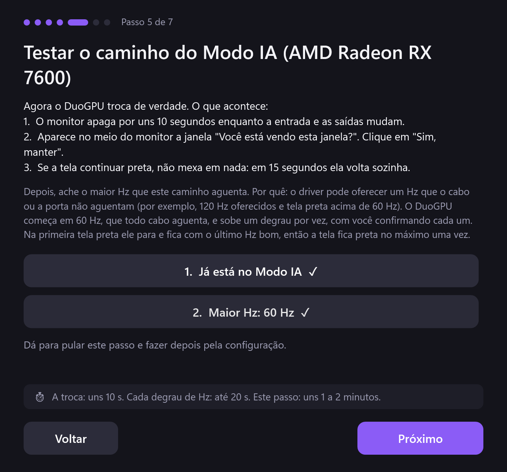
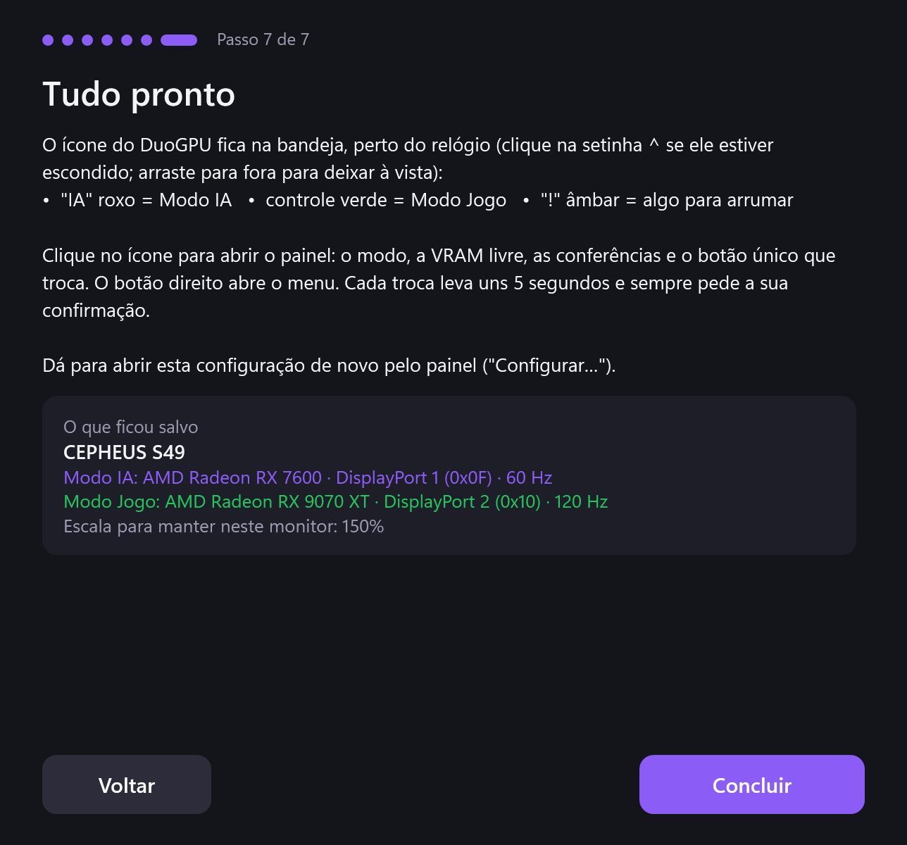
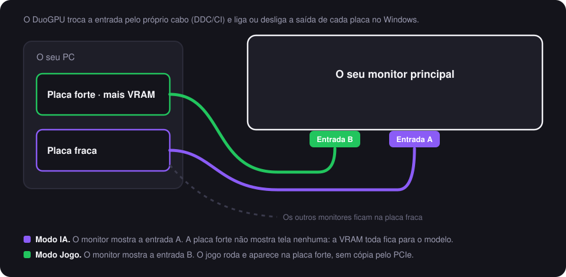

<p align="center">
  
</p>

# DuoGPU: um clique leva o seu monitor principal de uma placa de vídeo para a outra

[](https://github.com/ThalzeronLabs/duogpu/actions/workflows/ci.yml)
[](https://github.com/ThalzeronLabs/duogpu/releases/latest)
[](#requisitos)
[](src/DuoGPU)
[](LICENSE)

[English](README.md) · **Português (Brasil)**

Você roda modelos de IA no próprio PC, que tem **duas placas de vídeo**: uma forte, com muita VRAM, e outra mais
fraca. Você quer a forte 100% livre para o modelo, mas o monitor principal está ligado nela, e o compositor do Windows
e o navegador ocupam gigabytes de VRAM e parte da placa sem você ver. Ligar o monitor na fraca resolve... até a hora de
jogar, quando o monitor precisa voltar para a forte.

**O DuoGPU resolve com um segundo cabo, sem trocar cabo nenhum.** Ligue o monitor principal nas *duas* placas, um cabo
em cada, em duas entradas diferentes do monitor. Depois, um clique:

- **Modo IA:** o monitor mostra a entrada da placa fraca. A forte não mostra tela nenhuma: a VRAM inteira fica para o
  modelo.
- **Modo Jogo:** o monitor mostra a entrada da placa forte. O jogo roda e aparece na mesma placa, sem cópia de quadros
  pelo PCIe.

O DuoGPU troca a entrada do monitor pelo próprio cabo (o DDC/CI), liga ou desliga a saída de cada placa no Windows,
mantém o arranjo das telas, a escala e os Hz, e pergunta *"Você está vendo esta janela?"* depois de cada troca: se
ninguém clicar, ele volta sozinho. Um ícone na bandeja mostra sempre o modo ativo.

## O que muda

Medido no meu PC (Radeon RX 9070 XT 16 GB + Radeon RX 7600 8 GB, um monitor de 5120×1440 e dois de 1920×1080), em
12 de novembro de 2026, com a área de trabalho parada:

| | O monitor na placa forte | **Modo IA** (o monitor na placa fraca) |
|---|---|---|
| A VRAM em uso na placa forte | 2,93 GB | **0,42–0,50 GB** |
| A carga 3D de outros programas na placa forte | até 45% (o compositor do Windows, `dwm.exe`) | **0%** |
| Um modelo de 27B (Q4_K_M, cache K/V em q8), a escrita | 53,3 tokens/s | 53,0 tokens/s (52,9 · 53,0 · 53,3) |
| O mesmo modelo, a leitura do prompt | 7,6 s | 7,4 s |

São cerca de **2,5 GB a mais de VRAM** para o modelo sem mudar mais nada: dá para uma quantização maior ou um contexto
mais longo. **Não é um ganho de velocidade:** com este modelo de 27B, a escrita ficou igual (dentro do ruído) e o
prompt ficou uns 3% mais rápido. Esse modelo (uns 16,5 GB com o cache) não cabe inteiro na placa forte, e a parte que
vai para a fraca agora divide a placa com os monitores; um modelo que caiba inteiro na forte pode se comportar
diferente. O que o DuoGPU garante é a memória e uma placa forte que nenhum outro programa usa.

## As telas

| Modo IA | Modo Jogo | Algo saiu do lugar | Depois de uma troca |
|---|---|---|---|
|  |  |  |  |

O ícone da bandeja:  Modo IA, Modo Jogo, precisa de atenção.

Essas imagens são desenhadas pelo próprio código do painel (`DuoGPU.exe render docs/images`). O Modo IA usa os valores
ao vivo do meu PC; o Modo Jogo e o alerta usam valores medidos no mesmo PC.

## A configuração guiada

Na primeira vez que você abre o DuoGPU, uma configuração de sete passos guia você por tudo. Cada passo diz o que vai
fazer, por quê e quanto tempo leva, antes de você clicar em qualquer coisa.

| 1. Boas-vindas | 3. As entradas | 5. Testar um caminho | 7. Tudo pronto |
|---|---|---|---|
|  |  |  |  |

Os outros passos mostram o que o DuoGPU achou (as suas placas, o monitor com dois cabos), as suas preferências (a
escala, iniciar com o Windows, o idioma) e o teste do caminho do Modo Jogo.

## Quanto tempo cada coisa leva

| Etapa | Tempo |
|---|---|
| Uma troca | uns 10 s (medido: 9,8 s e 9,9 s) |
| Se ninguém confirmar (tela preta) | 15 s, e ele volta sozinho |
| O teste de Hz de um caminho | uns 1 a 2 min (cada degrau até 20 s) |
| A primeira configuração inteira | uns 3 a 5 min |
| Uma conferência do guarda | alguns milissegundos, a cada 5 s |

**Tudo em detalhe** (o que acontece em cada modo, cada passo de uma troca, cada teste e por quê, onde ficam os arquivos):
[docs/how-it-works.pt-BR.md](docs/how-it-works.pt-BR.md).

## Como funciona

<p align="center">
  
</p>

Uma troca segue uma ordem testada no hardware de verdade:

1. **Primeiro a entrada do monitor, pelo cabo que ele mostra agora.** Muitos monitores só respondem ao DDC/CI pela
   entrada ativa, então o DuoGPU manda o código VCP `0x60` (a entrada) antes de mexer em qualquer outra coisa.
2. **A saída da outra placa liga** na mesma posição, no mesmo tamanho e como tela principal, se era, no maior Hz que
   aquele caminho comprovadamente aguenta.
3. **A saída antiga desliga**, para o Windows não ver o monitor duas vezes.
4. **A escala volta** à sua: o Windows guarda uma escala por cabo e a zera a cada troca.
5. **"Você está vendo esta janela?"** Se ninguém clicar em *Manter* em 15 segundos (porque a tela ficou preta), o
   DuoGPU desfaz a troca, como o Windows faz depois de mudar a resolução.

Um **guarda** confere as telas a cada 5 segundos. Ele conserta sozinho o que nunca apaga a tela (a escala, o Hz
testado e o tamanho, os Hz e a posição dos seus *outros* monitores, como você guardou) e deixa o ícone âmbar, com o botão *Arrumar agora*, para o resto, como o monitor aparecendo duas vezes.

> **Por que um limite de Hz testado?** O driver pode oferecer um Hz que o cabo ou a porta não aguentam. No meu PC, o
> Windows ofereceu 120 Hz no caminho DisplayPort da placa fraca, e a tela ficou preta a 75, 100 e 120 Hz; a 60 Hz deu
> imagem. A configuração acha esse limite com você olhando, um degrau de cada vez, e o DuoGPU nunca passa dele.

Tudo usa APIs públicas do Windows: o DXGI para as placas, a API de configuração de telas para os caminhos e a escala, a
API clássica de configurações de vídeo para as saídas, a `dxva2` para o DDC/CI e os contadores de desempenho para a
VRAM. Por isso funciona do mesmo jeito com placas AMD, NVIDIA e Intel. Não pede administrador e não manda nada pela
internet.

## Requisitos

- Windows 10 ou Windows 11, x64.
- Duas placas de vídeo, cada uma com as suas saídas.
- Um monitor principal com duas entradas livres, e um cabo de cada placa até ele.
- **O DDC/CI ligado** no menu do monitor (a maioria já vem com ele ligado). Sem ele, o DuoGPU funciona assim mesmo: ele
  pede para você apertar o botão de entrada do monitor.

**Testado em:** Radeon RX 9070 XT + Radeon RX 7600, com um monitor DisplayPort de 5120×1440: uma troca em cada sentido, confirmada na tela, uns 10 s cada (12/11/2026). Se funcionar (ou não) no
seu hardware, [abra uma issue](https://github.com/ThalzeronLabs/duogpu/issues) com a saída do `DuoGPU.exe detect`: é
o jeito mais rápido de aumentar a lista.

## Instalar

1. Baixe o `DuoGPU-vX.Y.Z-win-x64.zip` da [última versão](https://github.com/ThalzeronLabs/duogpu/releases/latest) e
   descompacte onde quiser (por exemplo, `%LOCALAPPDATA%\Programs\DuoGPU`). É um `.exe` só, com o .NET dentro. Tem
   também a versão `-framework`, menor, para quem já tem o .NET 10 Desktop Runtime.
2. Rode o `DuoGPU.exe`. O exe ainda não tem assinatura digital, então o SmartScreen do Windows pode perguntar
   *"Executar assim mesmo?"* na primeira vez. Cada versão traz o SHA-256 dos arquivos.
3. A configuração abre sozinha:
   - ela mostra o monitor que achou nas duas placas e escolhe para a IA a placa com mais VRAM;
   - ela lê pelo DDC/CI a entrada que está na tela; você escolhe a entrada onde está o cabo da outra placa;
   - os passos 5 e 6 trocam de verdade para cada modo e acham o maior Hz de cada caminho, com você confirmando.
4. O ícone fica na bandeja (a setinha `^` perto do relógio). Arraste ele para fora para deixar sempre à vista.

## Linha de comando

```text
DuoGPU.exe              o app da bandeja (a configuração abre na primeira vez)
DuoGPU.exe detect       o que o DuoGPU vê: as placas, as saídas, o monitor de cabo duplo (não muda nada)
DuoGPU.exe status       o modo atual e as conferências do guarda
DuoGPU.exe ai           o Modo IA
DuoGPU.exe game         o Modo Jogo
DuoGPU.exe toggle       o outro modo
DuoGPU.exe fix          os consertos seguros do guarda, uma vez
DuoGPU.exe remember     guarda os outros monitores como estão agora
  --no-confirm          sem o "Você está vendo?" (para scripts, só depois de uma troca testada)
```

Assim, o script que sobe o servidor do modelo pode chamar `DuoGPU.exe ai` antes, e um atalho de jogo pode chamar
`DuoGPU.exe game`. O código de saída 0 quer dizer que deu certo.

## Sem o segundo cabo?

Dá para deixar o monitor na placa fraca e jogar na forte: o Windows desenha o jogo numa placa e mostra na outra
(*Configurações → Sistema → Vídeo → Elementos gráficos*). Só que cada quadro é copiado pelo PCIe, o que custa FPS e
aumenta a latência, mais ainda com a placa fraca num slot do chipset. Os dois cabos do DuoGPU evitam essa cópia.

## Compilar você mesmo

```bash
dotnet test tests/DuoGPU.Tests
dotnet publish src/DuoGPU -c Release -r win-x64 --self-contained -p:PublishSingleFile=true
```

Os testes cobrem o que não precisa de hardware: os ids de monitor do EDID, a leitura das capacidades do DDC/CI, a
escolha do Hz dentro do limite testado e o arquivo de configuração. O código das telas é testado no hardware de verdade
antes de cada versão.

## Próximos passos

- No Modo IA, levar também o navegador e os apps de conversa para a placa fraca (a preferência de GPU por app do
  Windows) e mostrar quais programas ainda usam a forte.
- Um pacote no `winget`.
- Mais de um monitor com dois cabos.

## Como eu construo isto

Eu uso a assistência de IA (o Claude) enquanto construo este projeto: para rascunhar, explorar opções e escrever os
testes. A ilustração do topo foi feita com um modelo de imagem. Eu reviso cada mudança, testo cada versão no meu próprio
PC com duas placas e respondo por cada linha.

## Sobre

O DuoGPU começou como um script para a minha mesa, onde rodo modelos de linguagem ao lado de um setup de jogo, e virou
uma ferramenta quando ficou bom o bastante para compartilhar. Eu sou o Esdras Souza, desenvolvedor Android e de IA, e
publico os meus projetos abertos na [Thalzeron Labs](https://thalzeronlabs.github.io/Site-Oficial/). Outros
repositórios: o [llama-kotlin](https://github.com/ThalzeronLabs/llama-kotlin) (LLMs no Android) e o
[android-on-device-llm](https://github.com/ThalzeronLabs/android-on-device-llm) (um chat de IA privado que roda no
celular).

## Licença

Apache-2.0 © Esdras Souza (Thalzeron Labs). Veja a [LICENSE](LICENSE). As versões para baixar levam dentro o runtime do .NET (MIT); os avisos dele estão em [THIRD-PARTY-NOTICES.txt](THIRD-PARTY-NOTICES.txt).
