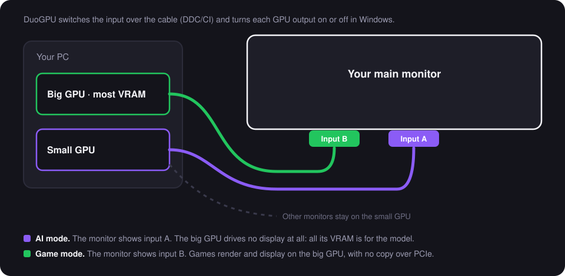

# How DuoGPU works, in detail

**English** · [Português (Brasil)](how-it-works.pt-BR.md) · [Back to the README](../README.md)

This page explains what DuoGPU does inside, what to expect in each mode, every check it runs and why, and how long
each step takes. No step is magic: everything below is a public Windows API you can read about.

## 1. The idea in one picture

A monitor with two inputs can be plugged into two GPUs at once. Windows then sees the same monitor on both GPUs, but
only one of them should drive it at a time, and the monitor only shows one input at a time. DuoGPU keeps those two
facts in sync: which GPU output is on in Windows, and which input the monitor shows.

## 2. What to expect in each mode

| | **AI mode** | **Game mode** |
|---|---|---|
| The shared monitor runs on | the small GPU | the big GPU (the one with more VRAM) |
| The big GPU drives | **no display at all** | the shared monitor |
| VRAM in use on the big GPU, idle (measured on my PC) | **0.42–0.50 GB** | 2.93 GB |
| Load on the big GPU from the desktop (`dwm.exe`, measured) | **0%** | up to 45% |
| Refresh rate of the shared monitor | the tested limit of the small GPU's path (60 Hz on my PC) | the tested limit of the big GPU's path (120 Hz on my PC) |
| Games | still run on the big GPU if you choose it in Windows' graphics settings, with a frame copy over PCIe | render and display on the same GPU, no copy |
| Your other monitors | stay where they are | stay where they are |
| The tray icon | purple "AI" | green gamepad |

**Why the VRAM drops so much:** every display a GPU drives needs framebuffers, and the Windows compositor
(`dwm.exe`) keeps the whole desktop of that display in the GPU's memory. Browsers and chat apps add their own
GPU-accelerated surfaces. When the big GPU drives no display, none of that lives there.

## 3. Inside a switch, step by step

Each switch runs this sequence (from `src/DuoGPU/Core/Switcher.cs`):

| # | What | Windows API | Why it is done this way |
|---|---|---|---|
| 1 | Read the input the monitor shows now and send the new one | DDC/CI through `dxva2.dll`: `GetVCPFeatureAndVCPFeatureReply` and `SetVCPFeature`, VCP code `0x60` | Many monitors answer DDC/CI only on the input they are showing, so the command goes through the cable that is on screen **before** that cable is turned off. |
| 2 | Turn on the other GPU's output, at the same position, size and primary flag, at the tested refresh limit | `ChangeDisplaySettingsEx` with `CDS_NORESET` | Staging all changes and applying them together avoids a moment with no primary monitor. |
| 3 | Turn off the old output | the same call, with a size of 0 | Otherwise Windows sees the monitor twice (one copy invisible) and windows can open on it. |
| 4 | Apply everything at once | `ChangeDisplaySettingsEx(null, …)` | One display reset instead of several. |
| 5 | Put the other monitors back where they were, if Windows moved them | `ChangeDisplaySettingsEx` | A topology change can shift the coordinates of the other displays. |
| 6 | Ask the monitor for the input again, through the new cable | DDC/CI | Some monitors only switch when asked on the active input. |
| 7 | Put the scale back | `DisplayConfigSetDeviceInfo` (the same call the Settings app uses) | Windows keeps one scale per cable and resets it to its recommendation when the cable changes. |
| 8 | "Can you see this window?" on the shared monitor | a WPF window placed by pixel coordinates | If the new path shows no picture, nobody can click, and the switch is undone after 15 seconds. |

Detection uses DXGI (`CreateDXGIFactory1`, `EnumAdapters1`) for the GPUs and their VRAM, the display configuration API
(`QueryDisplayConfig`, `DisplayConfigGetDeviceInfo`) to map each output to its GPU and read the monitor's EDID name,
and `EnumDisplayDevices` for the outputs. A GPU is remembered by its PCI device path, not by its LUID, because the LUID
changes at every boot. The VRAM in use comes from the performance counter `GPU Adapter Memory(...)\Dedicated Usage`,
the same number Task Manager shows.

## 4. Every check, and why

### The guard (every 5 seconds, while the tray app runs)

| Check | Why | What happens if it fails |
|---|---|---|
| The shared monitor shows up **once** | If both outputs are on, Windows sees an invisible copy of the monitor and windows can open there. | Amber icon, a notification, and **Fix now** (it switches to the last confirmed mode). |
| The shared monitor is on through **some** GPU | A cable unplugged or a driver reset can leave it off. | Amber icon and **Fix now**. |
| The **scale** is the one you chose | Windows resets it when the cable changes. | Fixed by itself (it never turns a screen off). |
| The **refresh rate** is the best one under the tested limit | Windows or a game can leave the monitor at a lower rate; a higher one could turn the screen black. | Fixed by itself, **only on a path whose limit was tested** with you watching. |

The guard reads the VRAM in use on the big GPU at the same time, for the panel.

### The setup tests (once, with you watching)

| Test | Why | How |
|---|---|---|
| A real switch to each mode | Proves that the inputs and the cables are what the setup thinks. | The switch above, with the confirmation window. |
| The refresh limit of each path | The driver can offer a refresh rate the cable or port cannot carry. On my PC, Windows offered 120 Hz on the small GPU's DisplayPort and the screen went black at 75, 100 and 120 Hz. | Start at 60 Hz, which every cable carries, then go up one step at a time while you confirm each one. The first step nobody confirms (because the screen went black) ends the test, and the last good rate is kept. The screen goes black at most once per path. |

### The automated tests (`tests/DuoGPU.Tests`, in CI on every change)

| What | Why |
|---|---|
| The EDID manufacturer and product code become the name Windows uses (`VIE0490`) | That name is how DuoGPU recognizes the same monitor on both GPUs. |
| The DDC/CI capabilities string parser finds the input list (`60(0F 10 11 12)`) and ignores look-alikes (`E60(...)`) | The setup offers only the inputs the monitor declares. |
| The refresh choice respects the tested limit, falls back sensibly, and an untested path starts at 60 Hz | A wrong choice here is what turns a screen black. |
| Calibration climbs from 60 Hz | The order is what keeps the screen black at most once. |
| The configuration file round-trips every field and survives a broken file | A broken file must start a fresh setup, never crash the tray. |

The display code itself needs real monitors and GPUs, so it is tested by hand on my PC before each release (the
README says which hardware).

## 5. How long each step takes

| Step | Time | Source |
|---|---|---|
| One switch (input + outputs + scale) | about 10 s (9.8 s and 9.9 s) | measured with DuoGPU 0.1.0 on my PC, both directions, 12 Nov 2026 |
| The confirmation window, if nobody clicks | 15 s, then the switch is undone (about 10 s more) | the setting `ConfirmSeconds` |
| One refresh step during the setup | about 2 s if you confirm quickly, up to about 20 s for the step that goes black | 1.5 s to apply + your click or the 15 s timeout |
| The refresh test of one path | about 1 to 2 minutes | estimate: 2 to 4 steps per path |
| The whole guided setup | about 3 to 5 minutes | estimate |
| One guard check | a few milliseconds, every 5 s | it only reads the display state |

## 6. Where things live

| What | Where |
|---|---|
| The configuration | `%APPDATA%\DuoGPU\config.json` (readable JSON: the shared monitor, the two GPUs, the inputs, the tested refresh limits, the scale) |
| The log of every switch | `%LOCALAPPDATA%\DuoGPU\duogpu.log` |
| Start with Windows | `HKCU\Software\Microsoft\Windows\CurrentVersion\Run\DuoGPU` (only if you tick it) |

Nothing else is written, nothing needs administrator rights, and nothing is sent over the network. To remove DuoGPU,
untick "Start with Windows" (or delete that registry value), quit it from the tray and delete the exe and the two
folders above.
