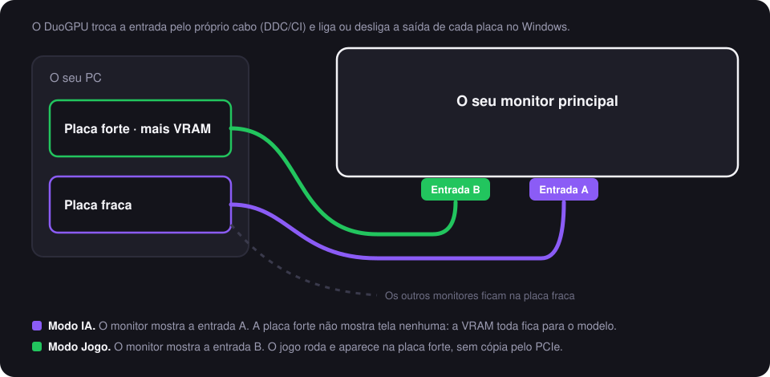

# Como o DuoGPU funciona, em detalhe

[English](how-it-works.md) · **Português (Brasil)** · [Voltar ao README](../README.pt-BR.md)

Esta página explica o que o DuoGPU faz por dentro, o que esperar de cada modo, cada teste que ele faz e por quê, e
quanto tempo cada etapa leva. Nada aqui é mágica: tudo abaixo é uma API pública do Windows, com documentação aberta.

## 1. A ideia numa imagem

Um monitor com duas entradas pode ficar ligado em duas placas ao mesmo tempo. O Windows passa a ver o mesmo monitor nas
duas placas, mas só uma delas deve mostrar imagem nele de cada vez, e o monitor só mostra uma entrada de cada vez. O
DuoGPU mantém essas duas coisas combinadas: qual saída de placa está ligada no Windows e qual entrada o monitor mostra.

## 2. O que esperar de cada modo

| | **Modo IA** | **Modo Jogo** |
|---|---|---|
| O monitor compartilhado roda na | placa fraca | placa forte (a de mais VRAM) |
| A placa forte mostra | **tela nenhuma** | o monitor compartilhado |
| A VRAM em uso na placa forte, parada (medido no meu PC) | **0,42–0,50 GB** | 2,93 GB |
| A carga da área de trabalho na placa forte (`dwm.exe`, medido) | **0%** | até 45% |
| Um modelo de 27B (Q4_K_M, K/V em q8), a escrita, 3 rodadas (medido) | 53,0 tokens/s | 53,3 tokens/s |
| Os Hz do monitor compartilhado | o limite testado do caminho da placa fraca (60 Hz no meu PC) | o limite testado do caminho da placa forte (120 Hz no meu PC) |
| Os jogos | rodam na placa forte se você escolher nas configurações de elementos gráficos do Windows, com cópia dos quadros pelo PCIe | são desenhados e mostrados na mesma placa, sem cópia |
| Os outros monitores | ficam onde estão | ficam onde estão |
| O ícone da bandeja | "IA" roxo | controle verde |

**Por que a VRAM cai tanto:** cada tela que uma placa mostra precisa de buffers de imagem, e o compositor do Windows
(o `dwm.exe`) guarda a área de trabalho inteira daquela tela na memória da placa. O navegador e os apps de conversa
somam as superfícies deles, aceleradas pela placa. Quando a placa forte não mostra tela nenhuma, nada disso fica nela.

**Por que a velocidade quase não muda:** gerar texto depende de quão rápido a placa lê os pesos do modelo na própria
memória, e uma área de trabalho parada quase não usa essa banda. Com um modelo de 27B no meu PC, a escrita ficou em 53
tokens/s nos dois modos (dentro do ruído) e o prompt ficou uns 3% mais rápido. Esse modelo não cabe inteiro na placa
forte, e a parte que vai para a fraca agora divide a placa com os monitores; um modelo que caiba inteiro na forte pode
se comportar diferente. O ganho certo é a memória: uns 2,5 GB a mais para os pesos ou o contexto, e uma placa forte
que nenhum outro programa usa.

## 3. Por dentro de uma troca, passo a passo

Cada troca segue esta sequência (em `src/DuoGPU/Core/Switcher.cs`):

| # | O quê | A API do Windows | Por que é feito assim |
|---|---|---|---|
| 1 | Ler a entrada que o monitor mostra agora e mandar a nova | o DDC/CI pela `dxva2.dll`: `GetVCPFeatureAndVCPFeatureReply` e `SetVCPFeature`, o código VCP `0x60` | Muitos monitores só respondem ao DDC/CI pela entrada que estão mostrando, então o comando vai pelo cabo que está na tela **antes** de esse cabo ser desligado. |
| 2 | Ligar a saída da outra placa na mesma posição, no mesmo tamanho e como tela principal, se era, no limite de Hz testado | `ChangeDisplaySettingsEx` com `CDS_NORESET` | Preparar todas as mudanças e aplicar juntas evita um instante sem tela principal. |
| 3 | Desligar a saída antiga | a mesma chamada, com tamanho 0 | Senão o Windows vê o monitor duas vezes (uma cópia invisível), e janelas podem abrir nela. |
| 4 | Aplicar tudo de uma vez | `ChangeDisplaySettingsEx(null, …)` | Um só reinício das telas em vez de vários. |
| 5 | Pôr os outros monitores de volta onde estavam, se o Windows os moveu | `ChangeDisplaySettingsEx` | Uma mudança de topologia pode deslocar as coordenadas das outras telas. |
| 6 | Pedir a entrada de novo ao monitor, agora pelo cabo novo | o DDC/CI | Alguns monitores só trocam quando o pedido vem pela entrada ativa. |
| 7 | Devolver a escala | `DisplayConfigSetDeviceInfo` (a mesma chamada que o app Configurações usa) | O Windows guarda uma escala por cabo e volta à recomendada quando o cabo muda. |
| 8 | "Você está vendo esta janela?" no monitor compartilhado | uma janela WPF posicionada em pixels | Se o caminho novo não der imagem, ninguém consegue clicar, e a troca é desfeita em 15 segundos. |

A detecção usa o DXGI (`CreateDXGIFactory1`, `EnumAdapters1`) para as placas e a VRAM delas, a API de configuração de
telas (`QueryDisplayConfig`, `DisplayConfigGetDeviceInfo`) para ligar cada saída à sua placa e ler o nome do monitor no
EDID, e o `EnumDisplayDevices` para as saídas. Cada placa é lembrada pelo caminho PCI, e não pelo LUID, porque o LUID
muda a cada vez que o PC liga. A VRAM em uso vem do contador `GPU Adapter Memory(...)\Dedicated Usage`, o mesmo número
que o Gerenciador de Tarefas mostra.

## 4. Cada teste, e por quê

### O guarda (a cada 5 segundos, enquanto o app da bandeja roda)

| Conferência | Por quê | O que acontece se falhar |
|---|---|---|
| O monitor compartilhado aparece **uma vez só** | Com as duas saídas ligadas, o Windows vê uma cópia invisível do monitor, e janelas podem abrir nela. | O ícone fica âmbar, vem um aviso e o botão **Arrumar agora** (volta ao último modo confirmado). |
| O monitor compartilhado está ligado por **alguma** placa | Um cabo solto ou um reinício do driver podem deixar ele desligado. | O ícone fica âmbar, com o **Arrumar agora**. |
| A **escala** é a que você escolheu | O Windows zera a escala quando o cabo muda. | Ele conserta sozinho (isso nunca apaga uma tela). |
| Os **Hz** são o melhor valor dentro do limite testado | O Windows ou um jogo podem deixar o monitor num Hz menor; um maior pode apagar a tela. | Ele conserta sozinho, **só num caminho cujo limite foi testado** com você olhando. |

O guarda lê ao mesmo tempo a VRAM em uso na placa forte, para o painel.

### Os testes da configuração (uma vez, com você olhando)

| Teste | Por quê | Como |
|---|---|---|
| Uma troca de verdade para cada modo | Prova que as entradas e os cabos são o que a configuração acha que são. | A troca descrita acima, com a janela de confirmação. |
| O limite de Hz de cada caminho | O driver pode oferecer um Hz que o cabo ou a porta não aguentam. No meu PC, o Windows ofereceu 120 Hz na DisplayPort da placa fraca, e a tela ficou preta a 75, 100 e 120 Hz. | Começa em 60 Hz, que todo cabo aguenta, e sobe um degrau por vez, com você confirmando cada um. O primeiro degrau sem confirmação (porque a tela apagou) encerra o teste, e fica o último Hz bom. A tela fica preta no máximo uma vez por caminho. |

### Os testes automáticos (`tests/DuoGPU.Tests`, no CI a cada mudança)

| O quê | Por quê |
|---|---|
| O fabricante e o código do produto no EDID viram o nome que o Windows usa (`VIE0490`) | É por esse nome que o DuoGPU reconhece o mesmo monitor nas duas placas. |
| A leitura das capacidades do DDC/CI acha a lista de entradas (`60(0F 10 11 12)`) e ignora os parecidos (`E60(...)`) | A configuração só oferece as entradas que o monitor declara. |
| A escolha do Hz respeita o limite testado, tem uma alternativa sensata, e um caminho não testado começa em 60 Hz | Uma escolha errada aqui é o que apaga a tela. |
| A calibração sobe a partir de 60 Hz | É essa ordem que deixa a tela preta no máximo uma vez. |
| O arquivo de configuração guarda e devolve todos os campos e sobrevive a um arquivo quebrado | Um arquivo quebrado tem de abrir uma configuração nova, nunca derrubar a bandeja. |

O código das telas precisa de monitores e placas de verdade, então ele é testado à mão no meu PC antes de cada versão
(o README diz em qual hardware).

## 5. Quanto tempo cada etapa leva

| Etapa | Tempo | De onde vem |
|---|---|---|
| Uma troca (entrada + saídas + escala) | uns 10 s (9,8 s e 9,9 s) | medido com o DuoGPU 0.1.0 no meu PC, nos dois sentidos, em 12/11/2026 |
| A janela de confirmação, se ninguém clicar | 15 s, e a troca é desfeita (uns 10 s a mais) | a configuração `ConfirmSeconds` |
| Um degrau de Hz na configuração | uns 2 s se você confirmar rápido, até uns 20 s no degrau que apaga | 1,5 s para aplicar + o seu clique ou os 15 s de espera |
| O teste de Hz de um caminho | uns 1 a 2 minutos | estimativa: 2 a 4 degraus por caminho |
| A configuração guiada inteira | uns 3 a 5 minutos | estimativa |
| Uma conferência do guarda | alguns milissegundos, a cada 5 s | ele só lê o estado das telas |

## 6. Onde as coisas ficam

| O quê | Onde |
|---|---|
| A configuração | `%APPDATA%\DuoGPU\config.json` (um JSON legível: o monitor compartilhado, as duas placas, as entradas, os limites de Hz testados, a escala) |
| O registro de cada troca | `%LOCALAPPDATA%\DuoGPU\duogpu.log` |
| Iniciar com o Windows | `HKCU\Software\Microsoft\Windows\CurrentVersion\Run\DuoGPU` (só se você marcar) |

Nada mais é gravado, nada pede administrador e nada é enviado pela internet. Para remover o DuoGPU, desmarque "Iniciar
com o Windows" (ou apague aquele valor do registro), saia pela bandeja e apague o exe e as duas pastas acima.
